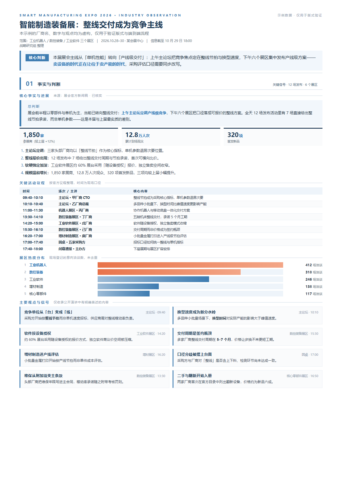
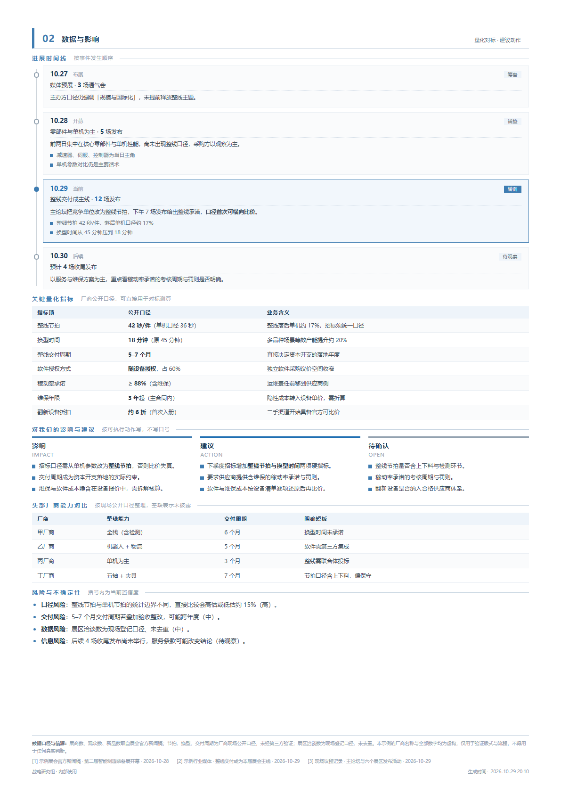
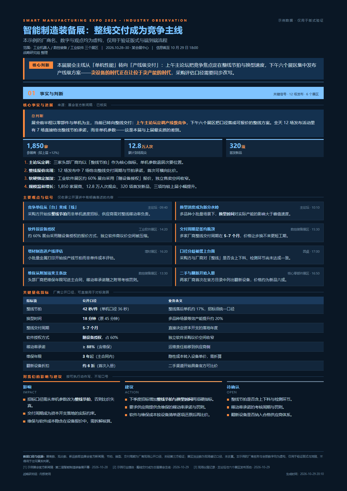
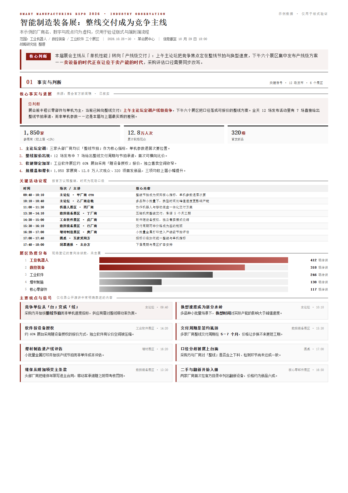

# jianbao — Executive Brief Generator

[](LICENSE)
[](https://www.python.org/downloads/)
[](https://github.com/difeijingscu/jianbao-skill/releases)

**Turn any topic into a 1–3 page A4 executive brief: researched, sourced, and typeset. One JSON file, three layouts, four color themes, HTML + PDF out.**

简体中文说明见 [README.zh-CN.md](README.zh-CN.md)。

---

Most "generate a report with AI" pipelines end in one of two places: a wall of markdown that nobody prints, or an HTML template that gets hand-edited until the numbers drift. `jianbao` takes a third route — **content is data, layout is an attribute**:

- The agent writes a single `content.json` (facts, numbers, sources, prose).
- `build.py` renders it into a fixed A4 grid, choosing which sections to keep based on a priority field.
- Switching style changes `data-layout` / `data-theme` — never the prose. Nothing from the previous run can leak into the next one.

The two gates are non-negotiable: **layout overflow must be 0px, and content validation must return 0 errors** before anything is delivered.

## Showcase

All four images are rendered from the same `assets/example/content.json` (fictional sample data) — same content, different style.

| Standard 2-page · Business Blue (`L1` / `T1`) | Page 2 |
|---|---|
|  |  |

| One-page digest · Dark Tech (`L2` / `T2`) | Full edition · Official Ink (`L3` / `T3`) |
|---|---|
|  |  |

## Requirements

- **Python 3.8+** — standard library only, no `pip install`.
- **A Chromium-based browser** (Chrome / Chromium / Edge) for layout measurement and PDF export.
  Auto-detected on Windows, macOS and Linux; override with `JB_BROWSER=/path/to/chrome`.
- **CJK fonts** for non-Chinese systems: `apt-get install fonts-noto-cjk` on Debian/Ubuntu.

## Install

There is nothing to `pip install` and no environment to activate — the scripts use the Python standard library only. Installing means **placing the folder** and, optionally, registering it as a skill.

### 1. Get the code

```bash
git clone https://github.com/difeijingscu/jianbao-skill.git
cd jianbao-skill
```

No Git? Use **Code → Download ZIP** on GitHub and unzip — the unpacked folder behaves identically.

### 2. Check the two prerequisites

```bash
python3 -c "import sys; print(sys.version)"     # 3.8 or newer
python3 -c "import sys; sys.path.insert(0,'scripts'); import config; print(config.browser())"
```

The second command must print a path to Chrome / Chromium / Edge. If it raises `未找到 Chrome/Edge`, install a Chromium browser or point at it explicitly:

```bash
export JB_BROWSER=/path/to/chrome        # Windows: set JB_BROWSER=C:\path\to\chrome.exe
```

On Windows the interpreter is usually `python`, not `python3`. Non-Chinese systems also need CJK fonts (see Requirements).

### 3. Choose how to use it

**A. As an agent skill** — the intended route. Copy the folder into the directory your host reads skills from; the folder name must be `jianbao` (it has to match `name:` in `SKILL.md`):

| Host | Install location |
|---|---|
| WorkBuddy | `~/.workbuddy/skills/jianbao` — Windows: `C:\Users\<you>\.workbuddy\skills\jianbao` |
| Claude Code | `~/.claude/skills/jianbao` (project-scoped: `.claude/skills/jianbao`) |
| other `SKILL.md` hosts | wherever that host loads skills from |

```bash
mkdir -p ~/.workbuddy/skills
cp -r jianbao-skill ~/.workbuddy/skills/jianbao
```

Start a new session, then just ask: *"给老板做一份 AI 芯片出口管制简报"*. The agent loads the skill, asks for layout and theme, researches, writes `content.json`, renders, and runs both gates.

**B. As a plain CLI** — no agent required. Leave the folder anywhere; every script is called by path:

```bash
S=/path/to/jianbao-skill/scripts
python3 $S/new_brief.py ./my-brief --topic "AI芯片出口管制"   # → my-brief/content.json (fill in the TODOs)
python3 $S/build.py my-brief/content.json --layout L1 --theme T1
python3 $S/check_layout.py 简报-*.html
python3 $S/validate.py my-brief/content.json --html 简报-*.html
python3 $S/to_pdf.py 简报-*.html
```

Optional shortcut if you use it regularly:

```bash
alias jb-build='python3 /path/to/jianbao-skill/scripts/build.py'
```

### 4. Verify the install

One minute, from the repo root, using the bundled fictional sample:

```bash
cd jianbao-skill
python3 scripts/build.py assets/example/content.json -o demo.html --layout L1 --theme T1
python3 scripts/check_layout.py demo.html
python3 scripts/validate.py assets/example/content.json --html demo.html
python3 scripts/to_pdf.py demo.html
```

Expected output:

```
HTML -> /…/demo.html
版式=L1(双页标准) 配色=T1(商务蓝) 段数=9 页数=2
OK  demo.html P1  overflow=0 cfill=81.5%
OK  demo.html P2  overflow=0 cfill=83.6%
---- 页数=2 最大溢出=0px 内容填充率低于 62% 的页=无
---- 通过：0 ERROR / 0 WARN
PDF -> /…/demo.pdf  size=357.1KB  pages=2
```

Two A4 pages, no overflow, no validation errors, one PDF — the environment is ready. Exact fill rates and PDF size vary slightly with fonts and browser version; what must hold is `overflow=0` and `0 ERROR`. `demo.html` / `demo.pdf` are throwaway files. If a step fails, see [references/troubleshooting.md](references/troubleshooting.md).

### 5. Update and uninstall

```bash
cd jianbao-skill && git pull           # update; a ZIP install: download and replace the folder
rm -rf ~/.workbuddy/skills/jianbao     # uninstall
```

Nothing is written outside the folder: no global state, no registry entries, no daemon.

## The five steps

```
0. confirm   scope + time window · layout · theme        (only what's unclear)
1. scaffold  new_brief.py      → content.json with TODOs
2. research  ≥3 independent sources, every number traced to its origin
3. write     content.json      3–10 sections, each tagged p=1|2|3
4. render    build.py          → A4 HTML
5. gate      check_layout.py   overflow = 0, fill rate ≥ 62%
             validate.py       0 ERROR
   deliver   to_pdf.py         → PDF
```

`validate.py` rejects the scaffold's `TODO`s on purpose: an unfilled skeleton cannot be delivered.

## Layouts and themes

Layouts are **structural** — they decide which sections survive. Themes are **purely cosmetic**.

| Code | Layout | Sections kept | Use |
|---|---|---|---|
| `L2` | One-page digest | `p=1` only | three minutes before a meeting |
| `L1` | Two-page standard | `p≤2` | default delivery |
| `L3` | Full edition | all | archiving, terminology, extended notes |

| Code | Theme | Use |
|---|---|---|
| `T1` | Business Blue | print, B&W photocopy, formal submission (default) |
| `T0` | Navy & Orange | on-screen circulation, high contrast |
| `T3` | Official Ink | government/formal style, greyscale + dark red |
| `T2` | Dark Tech | projection; ink-heavy, not for printing |

Switching **theme** is in-place: `restyle.py brief.html --theme T2 --pdf`.
Switching **layout** must re-render: `build.py content.json --layout L2`. `restyle.py --layout` refuses and tells you the right command — layout filtering happens at render time, so it cannot be done by CSS.

## Block types

| `type` | Purpose | Key fields |
|---|---|---|
| `lead` | headline judgement, dark band | `label` `text` |
| `metrics` | 3–4 key numbers | `items[].value/unit/label` |
| `list` | numbered or bulleted points | `items` `ordered` |
| `cards` | parallel viewpoints, 2–3 columns | `cols` `items[].title/right/tag/text/hi` |
| `columns` | three-column contrast (impact / action / open) | `items[].title/sub/items` |
| `table` | quantified metrics, side-by-side comparison | `head` `widths` `rows` |
| `agenda` | timetable (time / party / content) | `head` `widths` `rows` |
| `bars` | share and heat distribution | `items[].label/value/pct/hi` |
| `timeline` | sequence of developments | `items[].date/phase/tag/stat/desc/items` |

Inline `<b>` and `<br>` are allowed in prose; `<script>`, `<style>` and `on*=` are rejected by `validate.py`.

## What the validator actually checks

`check_layout.py` answers "was anything silently cut off?" — `.page` is a fixed `297mm` with `overflow: hidden`, so overflow disappears without an error. It also reports **fill rate**, because a page that is only 60% full is a different failure that overflow checks miss.

`validate.py` covers what a visual check cannot:

- required fields, section count, block schema
- leftover placeholders (`TODO`, `待补`, `{{`)
- page count vs. layout ceiling
- metric values that never appear in the body text (a reliable signal of inconsistent denominators)
- **period labels in titles** — `Day2`, `第 2 天`, `第 3 期` are rejected, because a brief is named after its topic, not after a day of some multi-day event

## Repository layout

```
SKILL.md                      the skill spec: rules, workflow, block reference
assets/
  skeleton.html               page shell, placeholders only — no sample content
  styles.css                  all styling: CSS variables × layouts
  example/content.json        fictional sample, used by the screenshots above
references/
  content-spec.md             every field of content.json + writing rules
  source-policy.md            source tiers, verification order, number discipline
  troubleshooting.md          environment requirements and known issues
scripts/
  new_brief.py                scaffold content.json
  build.py                    content.json → HTML
  check_layout.py             overflow + fill-rate measurement (headless Chrome)
  validate.py                 structure, placeholders, naming, number consistency
  to_pdf.py                   HTML → A4 PDF
  restyle.py                  switch theme in place
  config.py                   browser / temp-dir detection
docs/images/                  screenshots
```

## Adding a theme

Themes are CSS variables, so a new one is about 12 lines in `assets/styles.css`:

```css
[data-theme="T4"] {
  --bg: #ffffff; --fg: #1a1a1a; --ink-2: #3d3d3d; --ink-3: #6b6b6b; --ink-4: #8f8f8f;
  --line: #dcdcdc; --panel: #f5f6f8; --brand: #0f5c4a; --brand-ink: #0f5c4a; --lead-mark: #0f5c4a;
}
```

Register the code in `build.py` (`THEMES`) and `restyle.py` (`THEMES`) and it appears in the CLI.

## Design notes

- **No `!important` overrides.** Earlier iterations themed by rewriting every class name; any layout change silently broke theming. Variables fixed that.
- **No sample content in the skeleton.** A template carrying last run's numbers is how wrong figures get copied forward.
- **Fill the page with information, not whitespace.** When fill rate is low, add a substantive section or drop to a smaller layout — never stretch spacing with `space-between`.
- **Numbers carry their denominator.** Every figure in a brief states its scope, window and source; the footer block records all of them.

## License

MIT — see [LICENSE](LICENSE). The sample content in `assets/example/content.json` is fictional and for layout validation only.
