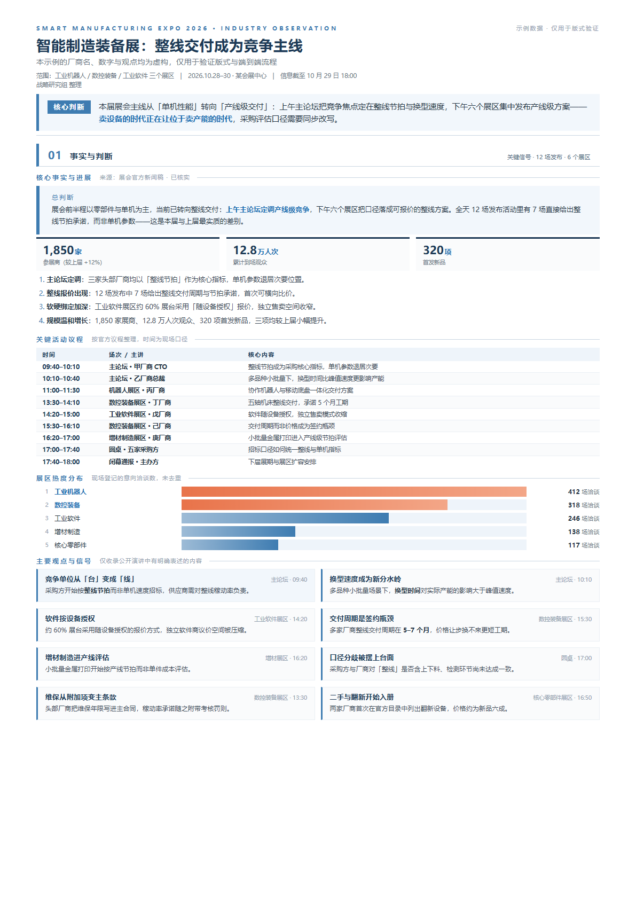
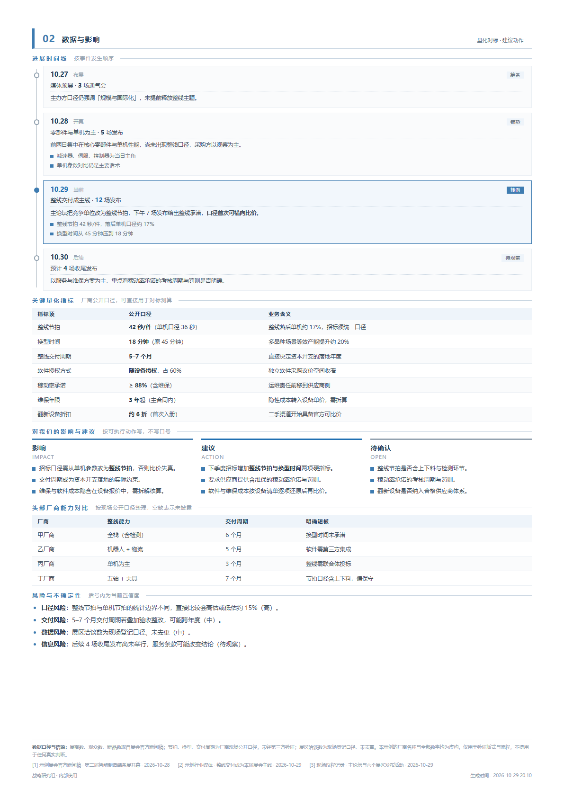
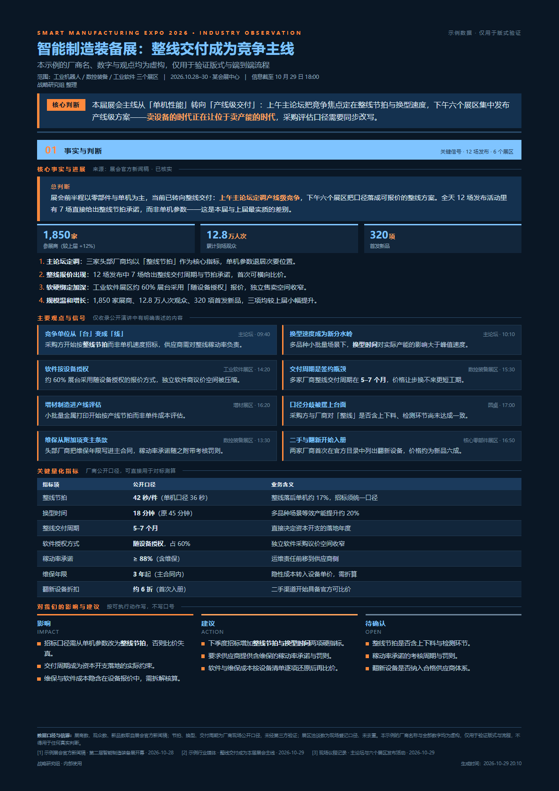
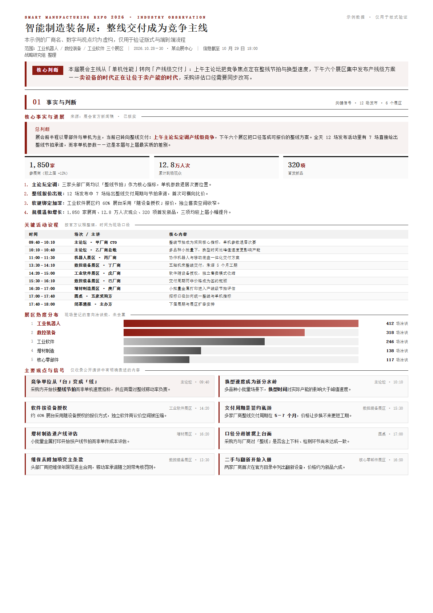

# jianbao · 高层简报生成器

[](LICENSE)
[](https://www.python.org/downloads/)
[](https://github.com/difeijingscu/jianbao-skill/releases)

**把任意主题压成 1–3 页 A4 高管简报：先检索核实，再定版出稿。一份 JSON，三套版式，四套配色，输出 HTML + PDF。**

English version: [README.md](README.md)

---

用 AI「生成一份报告」通常会落到两个坑里：要么是一大段没人打印的 markdown，要么是一个 HTML 模板被手工改到数字都对不上。`jianbao` 走第三条路——**内容是数据，版式是属性**：

- 由 Agent 写一份 `content.json`（事实、数字、信源、正文）；
- `build.py` 把它渲染进固定的 A4 网格，按优先级字段决定保留哪些段落；
- 换风格只改 `data-layout` / `data-theme`，**正文一个字不动**；上一次的内容不可能残留到这一次。

交付前两道闸门不可跳过：**版面溢出必须为 0px，内容校验必须 0 ERROR**。

## 效果

以下四张图由同一份 `assets/example/content.json`（虚构示例数据）渲染——内容相同，风格不同。

| 双页标准 · 商务蓝（`L1` / `T1`） | 第 2 页 |
|---|---|
|  |  |

| 单页精要 · 深色科技（`L2` / `T2`） | 完整版 · 公文墨（`L3` / `T3`） |
|---|---|
|  |  |

## 环境要求

- **Python 3.8+**，只用标准库，无需 `pip install`。
- **Chromium 内核浏览器**（Chrome / Chromium / Edge），用于版面测量与导出 PDF。
  Windows / macOS / Linux 均自动探测；自定义安装位置用 `JB_BROWSER=/path/to/chrome` 指定。
- **中文字体**：非中文系统需装，如 `apt-get install fonts-noto-cjk`，否则渲染成方框。

## 安装

不需要 `pip install`，也没有虚拟环境要激活——脚本只用 Python 标准库。所谓安装，就是**把文件夹放到位**，可选的再注册成一个 skill。

### 1. 获取代码

```bash
git clone https://github.com/difeijingscu/jianbao-skill.git
cd jianbao-skill
```

没装 Git 也行：在 GitHub 页面点 **Code → Download ZIP** 解压，效果完全一样。

### 2. 检查两个前置条件

```bash
python3 -c "import sys; print(sys.version)"     # 需 3.8 以上
python3 -c "import sys; sys.path.insert(0,'scripts'); import config; print(config.browser())"
```

第二条必须打印出 Chrome / Chromium / Edge 的路径。如果报 `未找到 Chrome/Edge`，装一个 Chromium 内核浏览器，或直接指定路径：

```bash
export JB_BROWSER=/path/to/chrome        # Windows：set JB_BROWSER=C:\path\to\chrome.exe
```

Windows 上的解释器通常叫 `python` 而不是 `python3`。非中文系统还需要中文字体，见上方「环境要求」。

### 3. 选择使用方式

**A. 作为 Agent skill**（推荐）。把文件夹放进宿主读取 skill 的目录，**目录名必须是 `jianbao`**（要与 `SKILL.md` 里的 `name:` 一致）：

| 宿主 | 安装位置 |
|---|---|
| WorkBuddy | `~/.workbuddy/skills/jianbao`，Windows 为 `C:\Users\<你>\.workbuddy\skills\jianbao` |
| Claude Code | `~/.claude/skills/jianbao`（项目级：`.claude/skills/jianbao`） |
| 其他 `SKILL.md` 宿主 | 该宿主约定的 skills 目录 |

```bash
mkdir -p ~/.workbuddy/skills
cp -r jianbao-skill ~/.workbuddy/skills/jianbao
```

开一个新会话，直接说需求即可，例如：*「给老板做一份 AI 芯片出口管制简报」*。Agent 会加载本 skill，问清版式与配色，检索、写 `content.json`、渲染、跑两道闸门。

**B. 作为普通命令行工具**（不依赖 Agent）。文件夹放在任意位置，脚本按路径调用：

```bash
S=/path/to/jianbao-skill/scripts
python3 $S/new_brief.py ./my-brief --topic "AI芯片出口管制"   # 产出 my-brief/content.json，填掉 TODO
python3 $S/build.py my-brief/content.json --layout L1 --theme T1
python3 $S/check_layout.py 简报-*.html
python3 $S/validate.py my-brief/content.json --html 简报-*.html
python3 $S/to_pdf.py 简报-*.html
```

常用的话可以加个别名：

```bash
alias jb-build='python3 /path/to/jianbao-skill/scripts/build.py'
```

### 4. 验证安装

在仓库根目录用自带的虚构示例跑一遍，约一分钟：

```bash
cd jianbao-skill
python3 scripts/build.py assets/example/content.json -o demo.html --layout L1 --theme T1
python3 scripts/check_layout.py demo.html
python3 scripts/validate.py assets/example/content.json --html demo.html
python3 scripts/to_pdf.py demo.html
```

预期输出：

```
HTML -> /…/demo.html
版式=L1(双页标准) 配色=T1(商务蓝) 段数=9 页数=2
OK  demo.html P1  overflow=0 cfill=81.5%
OK  demo.html P2  overflow=0 cfill=83.6%
---- 页数=2 最大溢出=0px 内容填充率低于 62% 的页=无
---- 通过：0 ERROR / 0 WARN
PDF -> /…/demo.pdf  size=357.1KB  pages=2
```

两页 A4、零溢出、零校验错误、出一个 PDF，环境就通了。填充率与 PDF 体积会因字体和浏览器版本略有差异，**只要 `overflow=0` 和 `0 ERROR` 成立即为正常**。`demo.html` / `demo.pdf` 是临时文件，可以直接删。哪一步失败，看 [references/troubleshooting.md](references/troubleshooting.md)。

### 5. 更新与卸载

```bash
cd jianbao-skill && git pull           # 更新；ZIP 安装则重新下载替换
rm -rf ~/.workbuddy/skills/jianbao     # 卸载
```

不在文件夹之外写任何东西：没有全局状态、不写注册表、不起后台进程。

## 五步流程

```
0. 确认   范围与时间窗 · 版式 · 配色          （只问不清楚的）
1. 建骨架 new_brief.py → 带 TODO 的 content.json
2. 检索   至少 3 个互相独立的信源，每个数字追到原始出处
3. 写内容 content.json，3–10 段，每段标 p=1|2|3 优先级
4. 渲染   build.py → A4 HTML
5. 闸门   check_layout.py  溢出 = 0，填充率 ≥ 62%
          validate.py      0 ERROR
   交付   to_pdf.py → PDF
```

`validate.py` 会拦下骨架里的 `TODO`——这是有意的：没填完的稿子不该被交付。

## 版式与配色

版式是**结构**（决定哪些段落留下），配色是**纯外观**。

| 代号 | 版式 | 保留段落 | 适用 |
|---|---|---|---|
| `L2` | 单页精要 | 仅 `p=1` | 会前 3 分钟看完 |
| `L1` | 双页标准 | `p≤2` | 默认交付形态 |
| `L3` | 完整版 | 全部 | 留档、术语、扩展说明 |

| 代号 | 配色 | 适用 |
|---|---|---|
| `T1` | 商务蓝 | 打印、黑白复印、正式呈报（默认） |
| `T0` | 深蓝橙 | 屏幕传阅，对比强 |
| `T3` | 公文墨 | 公文风格，黑白灰 + 暗红 |
| `T2` | 深色科技 | 投屏演示；费墨，不建议打印 |

换**配色**是原地操作：`restyle.py 简报.html --theme T2 --pdf`。
换**版式**必须重建：`build.py content.json --layout L2`。`restyle.py --layout` 会直接拒绝并给出正确命令——版式是渲染期的段落筛选，CSS 改不了已经生成的 DOM。

## 区块类型

| `type` | 用途 | 关键字段 |
|---|---|---|
| `lead` | 总判断，深色横条 | `label` `text` |
| `metrics` | 3–4 个关键数字 | `items[].value/unit/label` |
| `list` | 编号或无序要点 | `items` `ordered` |
| `cards` | 并列观点，2–3 列 | `cols` `items[].title/right/tag/text/hi` |
| `columns` | 三栏对照（影响 / 建议 / 待确认） | `items[].title/sub/items` |
| `table` | 量化指标、横向对比 | `head` `widths` `rows` |
| `agenda` | 议程、日程（时间 / 主体 / 内容） | `head` `widths` `rows` |
| `bars` | 占比、热度分布 | `items[].label/value/pct/hi` |
| `timeline` | 进展脉络 | `items[].date/phase/tag/stat/desc/items` |

正文允许内联 `<b>` `<br>`；`<script>`、`<style>`、`on*=` 会被 `validate.py` 拦下。

## 校验到底查什么

`check_layout.py` 回答「有没有东西被静默裁掉」——`.page` 固定 `297mm` 且 `overflow: hidden`，超出的内容不会报错，直接消失。它同时输出**填充率**，因为「一页只填 60%」是另一类翻车，只查溢出发现不了。

`validate.py` 管肉眼查不出来的部分：

- 必填字段、段落数量、区块结构
- 残留占位符（`TODO`、`待补`、`{{`）
- 页数是否超过版式上限
- 指标值是否在正文中出现过（口径前后不一致的可靠信号）
- **标题里的期次编号**：`Day2`、`第 2 天`、`第 3 期` 一律判错——简报按主题命名，不按某个多日活动的第几天命名

## 目录结构

```
SKILL.md                      skill 规范：铁律、流程、区块速查
assets/
  skeleton.html               页面骨架，只有占位标记，无任何示例内容
  styles.css                  全部样式：CSS 变量 × 版式
  example/content.json        虚构示例，上方截图即由它渲染
references/
  content-spec.md             content.json 全字段 + 写作规范
  source-policy.md            信源分级、核实顺序、数字纪律
  troubleshooting.md          环境要求与已知问题
scripts/
  new_brief.py                生成 content.json 骨架
  build.py                    content.json → HTML
  check_layout.py             溢出 + 填充率测量（无头 Chrome）
  validate.py                 结构、占位符、命名、数字自洽
  to_pdf.py                   HTML → A4 PDF
  restyle.py                  原地换配色
  config.py                   浏览器与临时目录探测
docs/images/                  截图
```

## 新增一套配色

配色就是 CSS 变量，在 `assets/styles.css` 里加 12 行即可：

```css
[data-theme="T4"] {
  --bg: #ffffff; --fg: #1a1a1a; --ink-2: #3d3d3d; --ink-3: #6b6b6b; --ink-4: #8f8f8f;
  --line: #dcdcdc; --panel: #f5f6f8; --brand: #0f5c4a; --brand-ink: #0f5c4a; --lead-mark: #0f5c4a;
}
```

再到 `build.py` 与 `restyle.py` 的 `THEMES` 里登记代号，命令行就能用。

## 设计取舍

- **不用 `!important` 覆盖。** 早期版本靠逐类名重写颜色做主题，版式一改就静默失效；变量解决了这个问题。
- **骨架里不放示例内容。** 模板夹着上一版的数字，是「错数被年复一年复制下去」的根源。
- **用信息填满页面，不用留白。** 填充率低时补实质内容或换小版式，绝不用 `space-between` 把版面撑满。
- **数字必须带口径。** 每个数字都写明统计范围、时间窗与来源；页脚汇总全部信源。

## 许可

MIT，见 [LICENSE](LICENSE)。`assets/example/content.json` 为虚构示例，仅用于版式验证。
